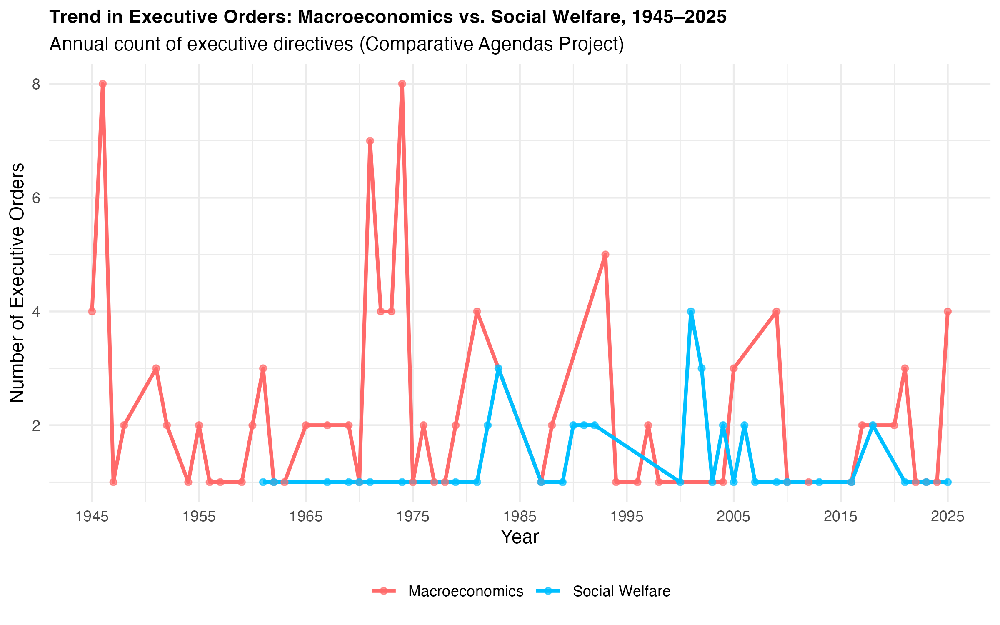
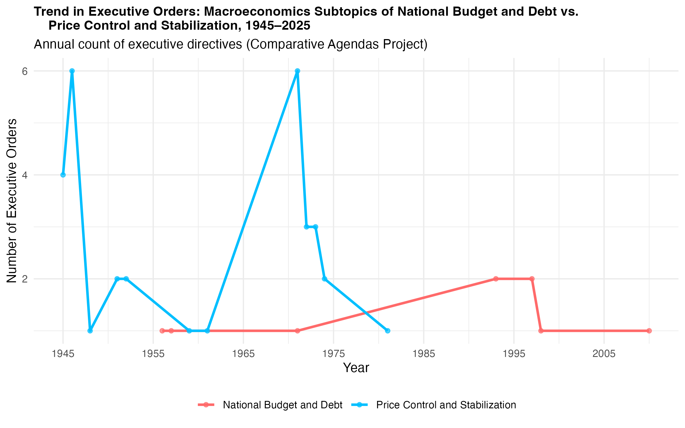
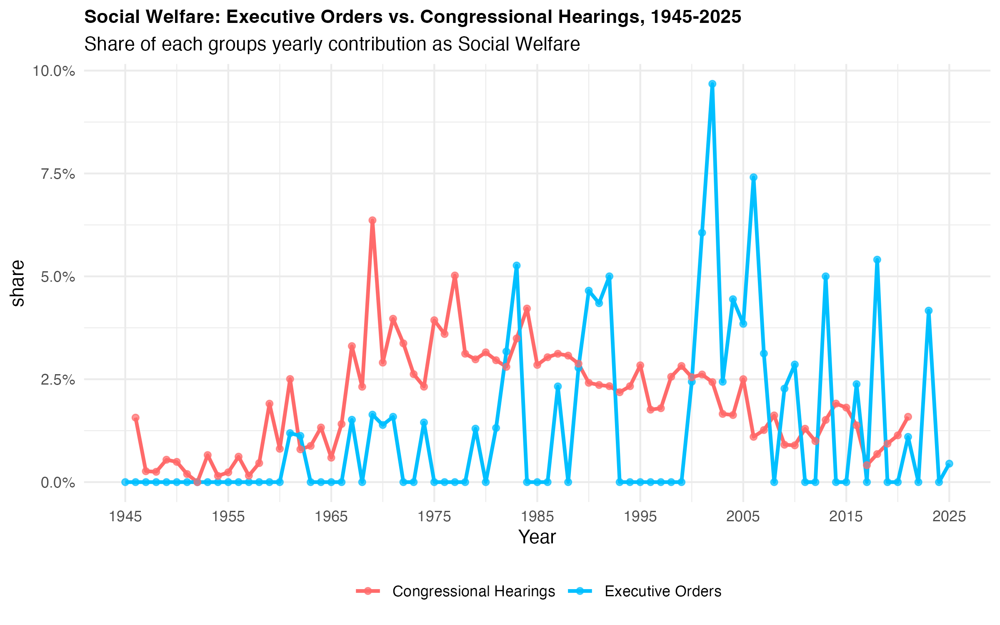
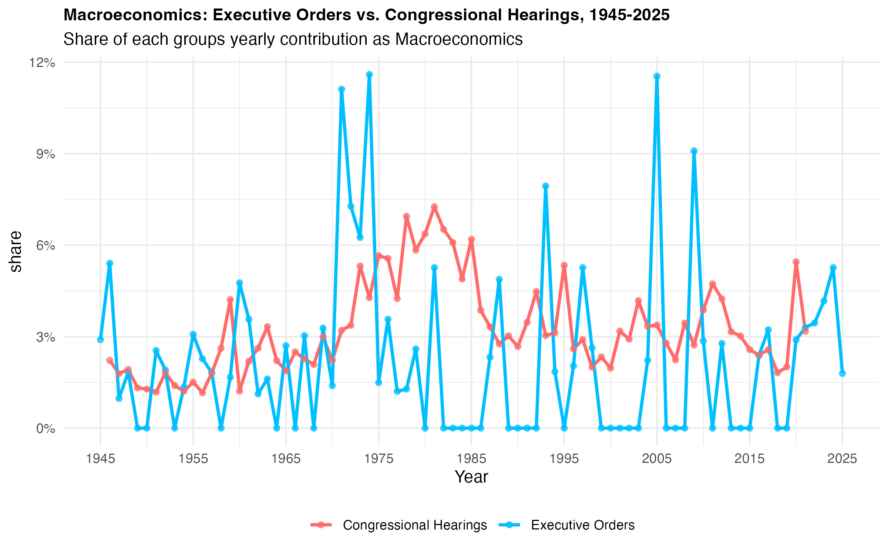

#Background 
**Background**: For today's Policy Agenda, I wanted to look at mainly two topics: Macroeconomics and Social Welfare. For me, as I studied Economics in Undergrad, it is something that is deeply important to me. The way that our government spends money, the decisions they make to help debt, etc. But also, I'm deeply interested at the state of our Social Welfare and how our government is providing these services and how well. 

## Figure 1: Trend within Executive Orders between Macroeconomics & Social Welfare
{fig-align="center" width="70%"}
This graph is showcasing the trend in Presidential Executive Orders from 1945-2025 between Macroeconomics and Social Welfare. It is showcasing that more Executive Orders have been about Macroeconomics compared to Social Welfare, which is something I've seen. THere are a few spikes of these orders being focused around Social Welfare, but the main concern is Macroeconomics. 

## Figure 2: The Trend in Executive orders about Microeconomics, but specifically with focusing on the subtopics of National Budget and Debt and Price Control and Stabilization.
{fig-align="center" width="70%"}

Figure 2 is showcasing the trend within Executive Orders about Macroeconomics, because there have been many, which ones are focused about National Budget and Debt vs. Price Control and Stabilization. Both are equally important and so I was really interested to see which subtopic was more in the Executive Orders.It turns out that Price Control and Stablization has been the subtopic of more Macroeconomics Executive Orders, specifically in two specific years. Compared to National Budget and Debt, there hasn't been too many Executive Orders signed. 

## Figure 3: Social Welfare and the Share between Executive Orders vs. Congressional Hearings, 1945-2025
{fig-align="center" width="70%"}

This figure is showcasing the amount of share each group has a contribution to Social Welfare topics. Congressional Hearings and Executive Orders both center the same topics, but I am interested to see between the two groups, who does more. This is showing that around 1965-1975, Congressional Hearings had a larger % of the share because they were covering the Social Welfare topic more compared to Executive Orders. But, as time goes on, we see that Executive Orders start to increase their share when dealing with topics like Social Welfare. 

## Figure 4: Macroeconomics and the Share between Executive Orders vs. Congressional Hearings, 1945-2025
{fig-align="center" width="70%"}

This graph is showcasing the amount of share each group has a contribution to Macroeconomics topics. Congressional Hearings and Executive Orders both center the same topics, but I am interested to see between the two groups, who does more. There are certain years where Executive Orders are increasing their share of the contribution about Macroeconomics like in 1970s, 2005, etc. But there are also times where the Congressional Hearings have a higher share than the Executive Orders, but there aren't that many times and the size isn't as big. 